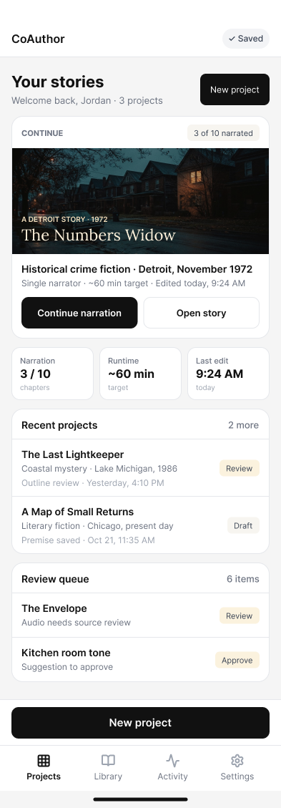
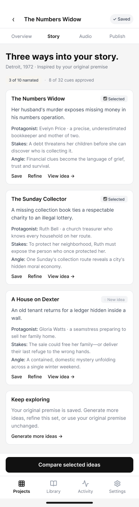
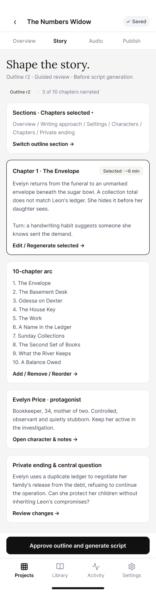
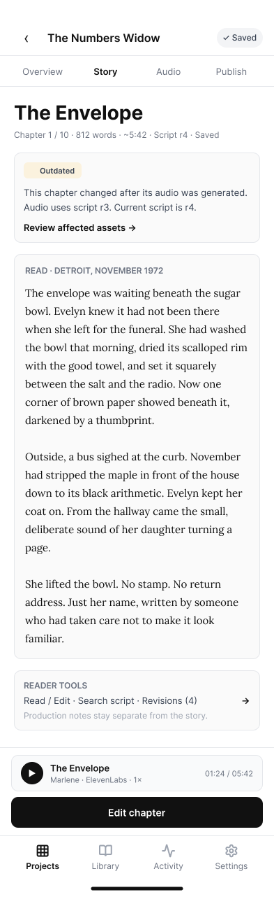
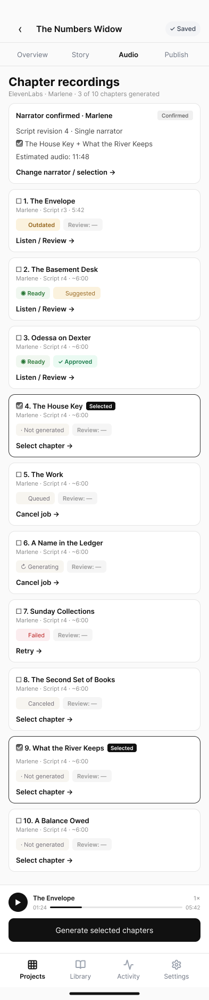
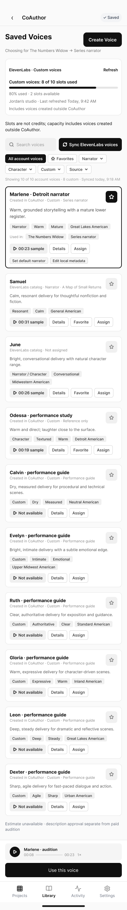

<p align="center">
  
</p>

# CoAuthor

An iOS app for story creation and audiobook preparation — ideation,
outlines, scripts, narration, sound cues, and publishing exports —
built with SwiftUI and SwiftData.

## Requirements

- Xcode 16 or later
- iOS 18.1 or later
- Node.js 20+ (optional, for the local backend)

## Getting Started

1. Clone the repository:
   ```sh
   git clone https://github.com/ridleytech/CoAuthor.git
   cd CoAuthor
   ```
2. Open `CoAuthor.xcodeproj` in Xcode.
3. Select a simulator or device and press **Cmd+R** to build and run.

The app seeds sample projects on first launch and is fully usable
offline — all generation flows run on deterministic local mocks.

## Screenshots

Design references the UI is built from (see
`docs/development-milestones.md` for per-screen notes):

| Projects                                              | Ideas                                          | Outline                                            |
| ----------------------------------------------------- | ---------------------------------------------- | -------------------------------------------------- |
|  |  |  |

| Script                                               | Narration                                           | Voices                                             |
| ---------------------------------------------------- | --------------------------------------------------- | -------------------------------------------------- |
|  |  |  |

## Architecture

MVVM with a coordinator navigation pattern and protocol-based
persistence boundaries:

- **Views** render state and dispatch actions; **`@Observable` view
  models** own behavior.
- **Repository protocols** (`CoAuthor/Persistence/`) are the only
  persistence boundary — SwiftData stays behind them so backend
  hydration can feed the same models.
- **`AppCoordinator`** owns typed routes, the selected tab, per-tab
  navigation paths, and sheets.
- **`CoAuthorSchemaV2`** + `CoAuthorMigrationPlan` give versioned
  schema migrations.
- `docs/development-milestones.md` documents the milestone-by-
  milestone build (M0–M17) with per-screen interpretations.

## Data sources: mock ⇄ backend

`BackendConfiguration.shared` is a global, persisted switch between
local mock data and the backend API. In the app:
**Settings → Developer → "Use backend data"** (default base URL
`http://localhost:3100`). Backend failures fall back to mock data,
so a down server never breaks the app.

## Local backend (`backend/`, gitignored)

A dependency-free Node.js AWS Lambda scaffold that mirrors the
app's client-side mocks:

```sh
cd backend
npm run local        # http://localhost:3100
```

- `PROVIDER_MODE=stub|live` flips between deterministic stub data
  and real OpenAI/ElevenLabs calls (per-provider — a missing key
  keeps just that provider stubbed).
- `AUDIO_STORAGE=inline|s3` returns generated audio/packages as
  base64 or uploads to S3 via SigV4-signed PUT (no AWS SDK).
- Export packages are real ZIP files built in pure Node.
- See `backend/README.md` for env vars and deploy instructions.

## Project Structure

- `CoAuthor/` — app source
  - `DesignSystem/` — theme tokens, buttons, cards, badges
  - `Models/` — SwiftData `@Model` types
  - `Persistence/` — repository protocols + SwiftData impls,
    seed data, versioned schema
  - `Features/` — one folder per screen group (Dashboard,
    Projects, Ideas, Outline, Script, Voices, Narration, Cues,
    Publishing, Library, Settings)
  - `Backend/` — API client, DTO decoding, `BackendConfiguration`
- `CoAuthorTests/` — unit tests (repositories, view-model logic,
  DTO contracts)
- `CoAuthorUITests/` — UI tests
- `backend/` — local Lambda scaffold (gitignored)
- `Designs/` — design references (gitignored)
- `docs/` — milestone documentation

## Testing

Run tests in Xcode with **Cmd+U**, or from the command line:

```sh
xcodebuild test -project CoAuthor.xcodeproj -scheme CoAuthor -destination 'platform=iOS Simulator,name=iPhone 16'
```

## License

Proprietary — see [LICENSE](LICENSE) for details.
